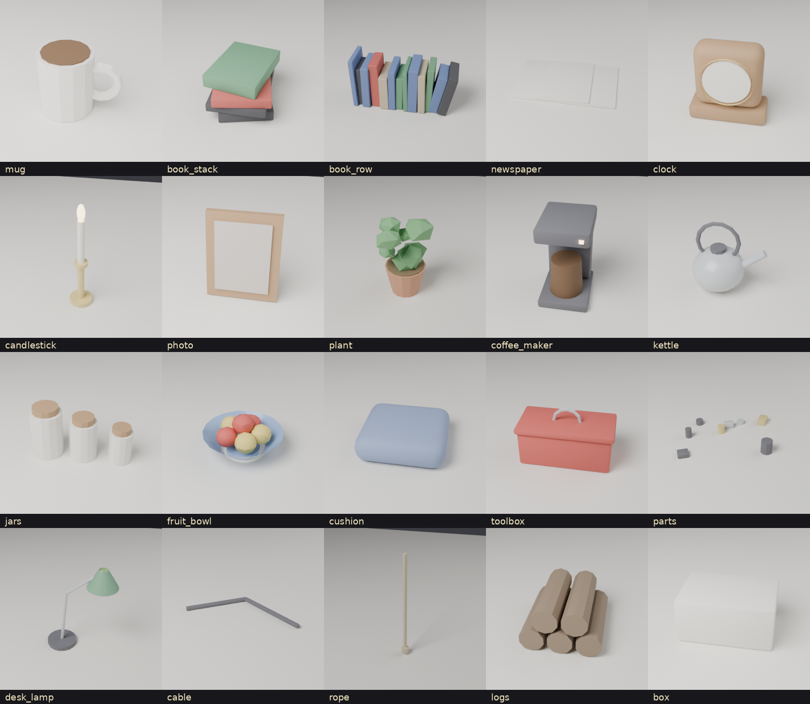

# Dressing — the small things that make a room lived in

*BUILD 63 (the look), 2026-11-17. The stage compiler (`forge/threed/blender/build_stage.py`, "LOOK 5") makes every one of these by rule from a short list, so a room is full of things that mean something without a generated model for each mug. The picture below is made by `forge/threed/blender/dressing_sheet.py`; its colours are plain stand-ins — in a game every thing is dressed by its material word, like every other plan-built solid.*



## How a place uses it

A place plan names its list: `"dressing": "<id>.dressing.json"` (a file beside the plan; `<id>.dressing.json` is found without being named). Compiling the place (3D → Places → **Compile again**, or `python -m forge 3d place compile <place.json>`) makes the things into the stage model and copies the list beside the stage, where the game reads it — a lit candle and a bench lamp become real lights.

```json
{"items": [
  {"kind": "mug", "at": [9.75, 8.42], "z": 0.42, "turn": 40},
  {"kind": "candlestick", "at": [12.1, 6.0], "z": 1.42, "lit": true},
  {"kind": "cable", "pts": [[10.2, 5.9, 0.02], [10.6, 6.4, 0.02], [11.0, 6.5, 0.02]]}
]}
```

Every item has `kind`, `at` (the plan position of its middle, metres: x east, y south) and `z` (the height of the surface it stands on); `turn` is degrees about the upright. `python -m forge 3d place check` and `place.check_dressing()` name an unknown kind or an item with no place.

## The kinds

| kind | what it makes | its own words |
|---|---|---|
| `mug` | a mug with coffee in it and a handle | `mat` (default `ceramic`) |
| `book_stack` | books lying on each other, each a little askew | `n` (3) |
| `book_row` | books standing on a shelf, one or two leaning | `w` (0.5 m of shelf) |
| `newspaper` | a folded paper with its top sheet a little open | |
| `clock` | a mantel clock: wooden case, a face, a brass ring | |
| `candlestick` | a brass candlestick with a candle | `h` (candle 0.14 m), `lit` (a flame, and the game makes a flickering light) |
| `photo` | a framed photograph, leaning back on its stand | `w`, `h` |
| `plant` | a houseplant in a terracotta pot | `r` (pot 0.11 m), `n` (9 leaves) |
| `coffee_maker` | a drip machine with its pot and a red light | |
| `kettle` | a round kettle with a handle and a spout | |
| `jars` | storage jars with wooden lids, tallest first | `n` (3) |
| `fruit_bowl` | a blue bowl of fruit | |
| `cushion` | a soft cushion | `w`, `d`, `mat` (default `cloth_blue`) |
| `toolbox` | a red toolbox with a handle | |
| `parts` | a scatter of small parts — bolts, blocks, fittings | `n` (6) |
| `desk_lamp` | a bench lamp on an arm, its head out over the work | the game makes a spot light under its head |
| `cable` | a cable along points | `pts` [[x, y, z], …] (two or more), `r`, `mat` |
| `rope` | a hanging rope | `h` (2.4 m) |
| `logs` | logs stacked in a pile | `n` (5) |
| `box` | anything else: a plain thing of a given size | `w`, `d`, `h`, `mat` (all four needed), `bevel` |

The rest of a room — the furniture that matters — is a generated model from the world list, set down by the place's `things`. A **room kit** (the things that dress most rooms of a world, made once and used everywhere) is the next step: see the game's BUILD 65.

## The other look switches a place plan may set

`"windows": "open"` (real openings with glass set back, a curtain each side, a rod — so the sun and the moon come through), `"trim": true` (a crown under the cut, a wainscot under old warm paper), `"bevel": 1.6` (every bevel scaled, so edges catch the light at a stage's distance), `"pictures": "engine"` (the frames and canvases are left to the game, which hangs real pictures). A plan that sets none is compiled exactly as before.
